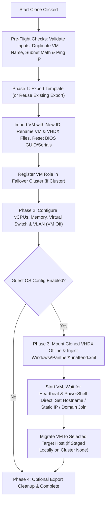

# HBS | Hyper-V VM Cloner GUI

**Script:** `HyperV-CloneVM-GUI-FULL.ps1`  
**Author:** Noah Huotari (HBS)  
**Log Directory:** `C:\hbs`

---

## 1. Overview

The **HBS Hyper-V VM Cloner** is a Windows Forms PowerShell utility that automates end-to-end virtual machine provisioning from a generalized (Sysprepped) Hyper-V template across **Failover Clusters** and **Standalone Hyper-V Hosts**.

### Key Features
* **Cluster & Standalone Support:** Automatically discovers VMs, active cluster hosts (`Get-ClusterNode`), Cluster Shared Volumes (`Get-ClusterSharedVolume`) with free-space reporting, and Virtual Switches (`Get-VMSwitch`).
* **Target Host & CSV Selection:** Deploy cloned VMs directly onto a specific cluster node and CSV root (`C:\ClusterStorage\<Volume>\<NewVMName>`), or manually specify a standalone target host.
* **Virtual Switch & VLAN Tagging:** Optionally attach the cloned VM's network adapter to a specific vSwitch and configure an Access VLAN ID (`1–4094`) or Untagged (`0`) prior to first boot.
* **Pre-Flight Safety Checks:**
  * Verifies template Sysprep state confirmation.
  * Checks for duplicate VM names across the cluster or target host before exporting.
  * Validates IP/Subnet/Gateway math and pings the target Static IP (`Test-Connection`) to warn of IP conflicts before cloning starts.
* **Zero-Touch OOBE (`unattend.xml` Offline Injection):** Mounts the cloned VHDX offline on the host, injects a dynamically generated `unattend.xml` into `Windows\Panther` using your template local Administrator password, and bypasses Windows OOBE prompts automatically.
* **PowerShell Direct Guest Customization:** Configures the Guest OS over Hyper-V VMBus (`Invoke-Command -VMName`) without requiring network connectivity first:
  * Renames the Guest OS computer name to match the VM name.
  * Configures Static IPv4 address, Subnet Mask (automatic CIDR prefix calculation), Default Gateway, and Primary/Secondary DNS servers.
  * Joins the VM to Active Directory.
* **Automatic Cross-Node Staging:** When running the script on one cluster node (e.g., `HV1`) while targeting another node (e.g., `HV2`) with Guest OS Configuration enabled, the script automatically stages the VM locally on `HV1` so offline VHDX mounting and PowerShell Direct execute locally over VMBus, then Live Migrates the VM to `HV2` (`Move-ClusterVirtualMachineRole`) upon completion.
* **Session Credential Caching:** Prompts once per GUI session for template local Admin and Active Directory credentials and reuses them for subsequent VM deployments (with a **Clear Saved Creds** button if you need to reset them).
* **Test Mode (Dry Run):** Enabled by default so engineers can preview every action in the log window before executing live changes.

---

## 2. Prerequisites

### Management / Execution Host
* **Run Location:** Run PowerShell **as Administrator** directly on a Hyper-V host (or on one of the nodes in the target Failover Cluster when using Offline VHDX Injection and PowerShell Direct Guest OS Configuration).
* **Required PowerShell Modules / Roles:**
  * `Hyper-V` PowerShell module
  * `FailoverClusters` PowerShell module (when deploying to a Hyper-V Cluster)

### Source Template VM Requirements
1. **Powered Off:** The source template VM must be in the `Off` state.
2. **Sysprepped (Generalized):** If using Guest OS Configuration, the template OS should be generalized with Sysprep prior to cloning:
   ```cmd
   C:\Windows\System32\Sysprep\Sysprep.exe /generalize /oobe /shutdown
   ```
3. **Local Administrator Account:** The built-in local `Administrator` account is configured during offline `unattend.xml` injection using the password you provide when prompted.

---

## 3. Step-by-Step Usage Guide

### Tab 1: `1. Clone VM`
1. **Host/Cluster FQDN:** Defaults to the local computer name (`$env:ComputerName`). Enter the Failover Cluster name/FQDN or standalone Hyper-V host name.
2. **Cluster?:** Check this box if connecting to a Failover Cluster.
3. **Click `Get VMs`:**
   * Queries all VMs from the cluster or standalone host.
   * If **Cluster?** is checked, populates **Target Host** with all `Up` cluster nodes and **Select CSV** with all Cluster Shared Volumes (displaying friendly path and available free space in GB).
   * Queries and populates **Virtual Switch** (`<Keep Template Switch>` by default, plus all discovered Hyper-V virtual switches).
4. **Select VM to Clone:** Choose your powered-off template VM.
5. **New VM Name:** Enter the name for the new VM (also used as the Guest OS hostname if selected on Tab 2).
6. **Target Host:** Select a cluster node from the dropdown or manually type a target Hyper-V host name.
7. **Select CSV:** *(Cluster mode only)* Select the target CSV where the VM folder (`<CSV>\<NewVMName>`) and temporary export (`<CSV>\Exports`) will be stored.
8. **Virtual Switch:** Leave on `<Keep Template Switch>` or select a target Virtual Switch.
9. **VLAN ID (Optional):** Leave blank to keep the template setting, enter `1–4094` to tag the VM network adapter in Access mode, or enter `0` to set the adapter to Untagged.

---

### Tab 2: `2. Post-Clone Config`
1. **VM Hardware (`Customize:`):**
   * Check **Customize:** to override the template's **vCPUs** and **Memory (GB)** (`StartupBytes`).
2. **Guest OS (`Perform Guest OS Configuration`):**
   * **Clear Saved Creds:** Clears any cached template/domain credentials stored in the current GUI session.
   * **Set Guest Hostname to VM Name:** Renames the Windows guest OS to match **New VM Name** and restarts the VM.
   * **Network (`Set Static IP Address`):**
     * Enter **IP**, **Subnet** (defaults to `255.255.255.0`), **GW** (Default Gateway), **DNS1**, and optional **DNS2**.
     * The script validates that the Gateway is on the same subnet as the IP and pings the IP before cloning to prevent IP conflicts.
   * **Active Directory (`Join Domain:`):**
     * Enter the target AD domain name (e.g., `contoso.com`).

---

### Executing the Deployment
1. **Test Mode (Dry Run):**
   * Checked by default. Leave checked to run a simulated deployment that validates settings and logs every step with `[TEST MODE]` without creating files or modifying VMs.
   * **Uncheck `Test Mode (Dry Run)`** when ready to perform the actual deployment.
2. **Click `Start Clone`:**
   * Confirm the Sysprep pre-flight prompt.
   * If **Perform Guest OS Configuration** is enabled (and credentials are not yet cached in this session), enter:
     1. The **Local `Administrator`** password to set/use for the template OS.
     2. The **Domain Join** credentials (if **Join Domain** is checked).
   * Monitor real-time progress in the **Log** window.

---

## 4. Workflow Phases (Under the Hood)



1. **Pre-Flight Checks:**
   * Confirms no VM with the same name exists in the cluster or target host.
   * Validates IPv4 address, subnet mask, and gateway segment math, then runs `Test-Connection` against the target IP.
2. **Phase 1 — Cloning (VM Off):**
   * Checks `<ExportPath>\<TemplateName>` for an existing `.vmcx` export and asks if you want to reuse it (saving export time when deploying multiple VMs from the same template).
   * Imports the VM with `-Copy -GenerateNewId` into `<BasePath>\<NewVMName>` and `<BasePath>\<NewVMName>\Virtual Hard Disks`.
   * Renames the VM and all attached `.vhdx` files (`<NewVMName>_<ControllerNumber>_<ControllerLocation>.vhdx`).
   * Generates a new random `BIOSGUID` and chassis/baseboard serial numbers via WMI (`root\virtualization\v2`).
   * Registers the VM in Failover Cluster Manager (`Add-ClusterVirtualMachineRole`) when deploying to a cluster.
3. **Phase 2 — Hardware & Network Adapter Config (VM Off):**
   * Applies custom vCPU count (`Set-VMProcessor`) and Startup Memory (`Set-VMMemory`).
   * Connects the VM network adapter to the selected Virtual Switch (`Connect-VMNetworkAdapter`) and configures the VLAN ID (`Set-VMNetworkAdapterVlan`).
4. **Phase 3 — Guest OS Configuration (VM On):**
   * Mounts the cloned VHDX offline (`Mount-VHD`), locates the Windows volume, writes `Windows\Panther\unattend.xml` to skip OOBE and set the local Administrator password, and dismounts the VHDX.
   * Boots the VM (`Start-VM`), waits for the Hyper-V **Heartbeat** service to report `OK`, and probes PowerShell Direct (`Invoke-Command -VMName`).
   * Injects the hostname change (`Rename-Computer`), waits for reboot, and then injects Static IP/DNS configuration (`New-NetIPAddress`, `Set-DnsClientServerAddress`) and Active Directory domain join (`Add-Computer`).
   * If staged locally on the current cluster node for PowerShell Direct, migrates the VM role to the selected target cluster node (`Move-ClusterVirtualMachineRole`).
5. **Phase 4 — Cleanup:**
   * Prompts whether to keep or delete the exported template folder (`<ExportPath>\<TemplateName>`). Keep the export if you are about to clone additional VMs in the same session.

---

## 5. Logging & Troubleshooting

* **Log File Location:** Every run automatically writes a timestamped log file to:
  ```text
  C:\hbs\CloneLog_<NewVMName>_<yyyyMMdd_HHmmss>.log
  ```
* **Common Troubleshooting Tips:**
  * **"Timed out waiting for Guest OS to become responsive to PowerShell Direct":**
    * Verify the source template was generalized with Sysprep (`/generalize /oobe /shutdown`).
    * Ensure the password entered in the Local Administrator credential prompt matches the template's local Administrator password (use **Clear Saved Creds** on Tab 2 if a typo was made).
    * Ensure the script is being run directly on a Hyper-V host/cluster node so local VMBus communication (`Invoke-Command -VMName`) is available.
  * **Domain Join Fails:**
    * Confirm the selected **Virtual Switch** and **VLAN ID** allow the guest VM to reach the configured **DNS1**/**DNS2** servers and Active Directory Domain Controllers.
